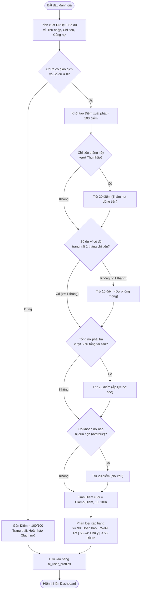
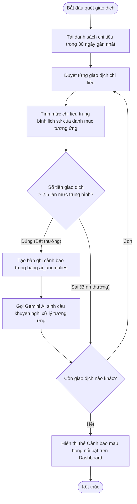
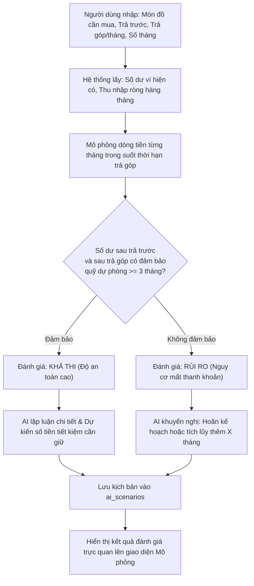
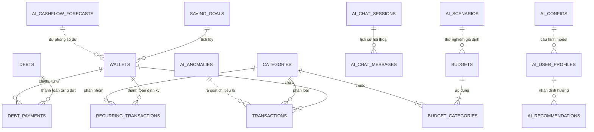

# BỘ HỒ SƠ PHÂN TÍCH VÀ THIẾT KẾ HỆ THỐNG THÔNG TIN
## MÔN HỌC: IS402 – HỆ THỐNG THÔNG TIN HỖ TRỢ RA QUYẾT ĐỊNH (DSS)

---

**ĐỀ TÀI:**  
### HỆ THỐNG HỖ TRỢ RA QUYẾT ĐỊNH TÀI CHÍNH CÁ NHÂN BẰNG TRÍ TUỆ NHÂN TẠO (AI-FDSS)
*(Personal Financial Decision Support System — Desktop Application)*

* **Khóa học / Học kỳ:** Học kỳ 1 – Năm học 2026–2027
* **Mã môn học:** IS402 – Decision Support Systems
* **Giảng viên hướng dẫn:** [Tên Giảng viên phụ trách môn học]
* **Nhóm thực hiện (Nhóm 5 thành viên):**
  1. Phạm Văn Long – Trưởng nhóm (Kiến trúc sư hệ thống & CI/CD)
  2. [Họ và tên SV 2] – Kỹ sư Backend & Cơ sở dữ liệu MySQL
  3. [Họ và tên SV 3] – Kỹ sư Trí tuệ Nhân tạo & Thuật toán DSS
  4. [Họ và tên SV 4] – Kỹ sư Frontend (Nghiệp vụ tài chính cốt lõi)
  5. [Họ và tên SV 5] – Kỹ sư Frontend (Trực quan hóa dữ liệu) & Đảm bảo chất lượng (QA)
* **Thời gian thực hiện:** 03/10/2026 – 12/12/2026 (10 tuần – 5 Sprints)

---

## MỤC LỤC TỔNG THỂ BÁO CÁO

* **LỜI MỞ ĐẦU & TÍNH CẤP THIẾT CỦA ĐỀ TÀI**
* **DANH MỤC THUẬT NGỮ & TỪ VIẾT TẮT**
* **CHƯƠNG 1: TỔNG QUAN & ĐẶC TẢ YÊU CẦU HỆ THỐNG (YÊU CẦU 1 & 2)**
  * 1.1 Khảo sát hiện trạng & Giới hạn của các phần mềm ghi chép thụ động
  * 1.2 Mục tiêu & Phạm vi của Hệ thống hỗ trợ ra quyết định (AI-FDSS)
  * 1.3 Cây phân rã chức năng nghiệp vụ (BFD – Business Function Diagram)
  * 1.4 Danh mục các bài toán hỗ trợ ra quyết định trọng tâm (Module 5)
  * 1.5 Sơ đồ Use Case tổng quát và kịch bản tương tác Use Case
* **CHƯƠNG 2: THIẾT KẾ LƯU ĐỒ QUY TRÌNH HỖ TRỢ RA QUYẾT ĐỊNH (FLOWCHARTS - YÊU CẦU 3)**
  * 2.1 Lưu đồ quy trình Đánh giá sức khỏe tài chính & Khẩu vị rủi ro
  * 2.2 Lưu đồ quy trình Quét & Cảnh báo chi tiêu bất thường (Anomaly Detection)
  * 2.3 Lưu đồ quy trình Dự báo dòng tiền tương lai (Time-Series Forecasting)
  * 2.4 Lưu đồ quy trình Mô phỏng kịch bản giả định What-If & Phê duyệt 1-Click
  * 2.5 Lưu đồ quy trình Trợ lý ảo AI Copilot tương tác qua RAG Finance
* **CHƯƠNG 3: THIẾT KẾ CƠ SỞ DỮ LIỆU & TRÍCH XUẤT SQL (YÊU CẦU 4 & 6)**
  * 3.1 Mô hình thực thể liên kết (ERD 17 bảng)
  * 3.2 Bảng từ điển dữ liệu chi tiết (Data Dictionary)
  * 3.3 Thiết kế bảng đa hình & Liên kết mềm cho các bảng AI DSS
  * 3.4 Các câu lệnh SQL nghiệp vụ phức tạp & Truy vấn phục vụ ra quyết định
  * 3.5 Cơ chế Tự động khởi tạo Database & Cấu trúc bảng khi sang máy mới
* **CHƯƠNG 4: THIẾT KẾ GIAO DIỆN NGƯỜI DÙNG & BÁO CÁO (GUI & REPORTS - YÊU CẦU 5 & 6)**
  * 4.1 Bố cục kiến trúc trải nghiệm người dùng (UX Architecture)
  * 4.2 Thiết kế Trung tâm chỉ huy Dashboard (KPI Cards, Khuyến nghị 1-Click, Cảnh báo)
  * 4.3 Thiết kế Module chuyên biệt Dự báo dòng tiền & Mô phỏng What-If
  * 4.4 Thiết kế Trợ lý AI Copilot Chatbot nổi toàn cục (Floating Widget)
  * 4.5 Thiết kế các mẫu báo cáo tài chính trực quan và xuất file CSV
* **CHƯƠNG 5: HIỆN THỰC HÓA MÃ NGUỒN, TÍCH HỢP AI & ĐÓNG GÓI (+ AI BONUS)**
  * 5.1 Kiến trúc công nghệ kết hợp (Electron + React 19 + MySQL + Gemini AI)
  * 5.2 Động cơ suy luận Trí tuệ nhân tạo (Google Gemini API & Kỹ thuật RAG)
  * 5.3 Quy trình kiểm thử phần mềm (Testing & Quality Assurance)
  * 5.4 Tự động hóa tích hợp & Triển khai liên tục (CI/CD GitHub Actions)
  * 5.5 Đóng gói bộ cài đặt độc lập cho Windows (.exe Installer)
* **CHƯƠNG 6: QUẢN LÝ DỰ ÁN THEO PHƯƠNG PHÁP LUẬN AGILE/SCRUM**
  * 6.1 Lịch trình 5 Sprint (10 tuần: 03/10/2026 – 12/12/2026)
  * 6.2 Ma trận phân công trách nhiệm 5 thành viên (RACI Matrix)
* **KẾT LUẬN & HƯỚNG PHÁT TRIỂN (EXPAND TO MOBILE)**
* **TÀI LIỆU THAM KHẢO & PHỤ LỤC**

---

# CHI TIẾT NỘI DUNG TỪNG CHƯƠNG TRONG HỒ SƠ

---

## LỜI MỞ ĐẦU & TÍNH CẤP THIẾT CỦA ĐỀ TÀI
* **Bối cảnh thực tế:** Trong thời đại kinh tế biến động, người trẻ và người đi làm thường gặp khó khăn trong việc quản lý chi tiêu cá nhân, mất kiểm soát nợ nần và không có quỹ dự phòng khẩn cấp.
* **Hạn chế của phần mềm truyền thống:** Đa số các ứng dụng hiện nay chỉ đóng vai trò là "cuốn sổ ghi chép điện tử thụ động" (nhập vào bao nhiêu thì hiện bấy nhiêu), không có khả năng phân tích, cảnh báo nguy cơ hay đưa ra lời khuyên hành động.
* **Giải pháp đề xuất (AI-FDSS):** Xây dựng một Hệ thống Thông tin Hỗ trợ Ra Quyết định (DSS) ứng dụng Trí tuệ Nhân tạo tạo sinh (Generative AI) và Chuỗi thời gian (Time-Series) để chủ động cảnh báo rủi ro, dự báo tương lai và đưa ra quyết định tối ưu dòng tiền chỉ bằng 1 cú nhấp chuột.

---

## DANH MỤC THUẬT NGỮ & TỪ VIẾT TẮT
* **DSS (Decision Support System):** Hệ thống thông tin hỗ trợ ra quyết định.
* **AI-FDSS:** Personal Financial Decision Support System by AI.
* **BFD (Business Function Diagram):** Sơ đồ phân rã chức năng nghiệp vụ.
* **ERD (Entity Relationship Diagram):** Sơ đồ quan hệ thực thể cơ sở dữ liệu.
* **RAG (Retrieval-Augmented Generation):** Kỹ thuật tăng cường truy xuất dữ liệu thực tế cho mô hình ngôn ngữ lớn.
* **What-If Analysis:** Phân tích mô phỏng kịch bản giả định.
* **Time-Series Forecasting:** Phương pháp dự báo chuỗi thời gian dựa trên biến động lịch sử.

---

## CHƯƠNG 1: TỔNG QUAN, MỤC TIÊU & ĐẶC TẢ YÊU CẦU HỆ THỐNG (YÊU CẦU 1 & 2)

### 1.1 Mục tiêu của dự án (Project Goals & Objectives)

#### a) Mục tiêu tổng quát (General Objective):
Xây dựng một Hệ thống Thông tin Hỗ trợ Ra Quyết định (Decision Support System - DSS) hoàn chỉnh trên môi trường máy tính cá nhân (Desktop Application) mang tên **AI-FDSS** (*Personal Financial Decision Support System by AI*). Hệ thống là sự kết hợp chặt chẽ giữa Cơ sở dữ liệu quan hệ MySQL 8.0, các mô hình toán học định lượng tài chính (Time-Series, Scoring Rules) và Trí tuệ Nhân tạo tạo sinh (Google Gemini AI) nhằm giúp người dùng cá nhân chủ động kiểm soát dòng tiền, ngăn ngừa nguy cơ vỡ nợ và đưa ra các quyết định can thiệp kịp thời chỉ với 1 cú nhấp chuột.

#### b) Mục tiêu cụ thể (Specific Objectives):
1. **Chuẩn hóa nghiệp vụ quản lý tài chính nền tảng (TPS):** Xây dựng các chức năng theo dõi ví tiền, quản lý danh mục thu/chi đa cấp, ghi chép giao dịch, lập lịch định kỳ, hạn mức ngân sách và quản lý sổ công nợ 2 chiều.
2. **Hiện thực hóa 5 bài toán Hỗ trợ Ra Quyết định (DSS) cốt lõi:**
   * **Đánh giá sức khỏe tài chính & Khẩu vị rủi ro:** Chấm điểm theo mô hình trừ điểm vi phạm (Penalty Model) với mức điểm chuẩn khởi tạo 100/100.
   * **Quét và phát hiện chi tiêu bất thường (Anomaly Detection):** Tự động phát hiện các khoản chi tiêu vượt 2.5 lần mức trung bình 90 ngày.
   * **Dự báo dòng tiền tương lai 3 tháng:** Sử dụng thuật toán Time-Series kết hợp tốc độ tăng trưởng để sinh 3 kịch bản số dư (Tích cực, Kỳ vọng, Thận trọng).
   * **Mô phỏng kịch bản giả định What-If:** Đối soát kế hoạch mua sắm tài sản lớn / trả góp với dòng tiền khả dụng trong tương lai.
   * **Trợ lý cố vấn tài chính AI Copilot:** Tư vấn chuyên sâu ngữ cảnh tài chính thực tế bằng tiếng Việt thông qua kỹ thuật RAG Finance.
3. **Trực quan hóa dữ liệu & Báo cáo quản trị:** Thiết kế trung tâm chỉ huy Dashboard ra quyết định trong 3 giây; tích hợp biểu đồ trực quan (Recharts) và chức năng xuất báo cáo định dạng CSV.
4. **Tự động hóa triển khai & Đóng gói sản phẩm:** Tích hợp module tự động sinh Database và bảng biểu khi sang máy mới (Zero-Config), thiết lập quy trình kiểm thử tự động CI/CD trên GitHub Actions và đóng gói bộ cài đặt độc lập (.exe Installer) trên Windows.

---

### 1.2 Phạm vi của dự án (Project Scope)

#### a) Phạm vi Chức năng (Functional Scope):
* **Bao gồm trong dự án (In-Scope):**
  * Quản lý đa tài khoản/ví tiền (tiền mặt, tài khoản ngân hàng, ví điện tử).
  * Ghi chép, phân loại và lập lịch giao dịch tài chính thu/chi.
  * Thiết lập ngân sách chi tiêu và tự động giám sát mức độ giải ngân.
  * Quản lý sổ nợ 2 chiều (Tôi nợ người khác / Người khác nợ tôi) và lịch trình trả nợ.
  * Tự động phân tích, cảnh báo chi tiêu lạ và đưa ra khuyến nghị can thiệp 1-Click.
  * Dự báo số dư 3 tháng tới và thử nghiệm kịch bản What-If mua sắm tài sản lớn.
  * Trò chuyện, vấn đáp với Trợ lý AI Copilot về tình hình tài chính thực tế.
  * Báo cáo phân tích thu chi, ngân sách, công nợ và xuất dữ liệu CSV.
* **Không bao gồm / Giới hạn hệ thống (Out-of-Scope):**
  * *Không liên kết trực tiếp Open Banking API:* Không kết nối tự động kéo số dư/thanh toán trực tiếp với các ngân hàng thương mại Việt Nam (do rào cản pháp lý và chi phí API doanh nghiệp). Dữ liệu được người dùng chủ động quản lý.
  * *Không giao dịch đầu tư tài chính thời gian thực:* Không hỗ trợ đặt lệnh mua/bán cổ phiếu, tiền mã hóa theo thời gian thực (real-time trading).
  * *Không phân quyền quản trị đa người dùng phức tạp (RBAC):* Hệ thống định vị là ứng dụng cá nhân hóa chạy độc lập (Single-User Desktop Privacy-First), đảm bảo quyền riêng tư tuyệt đối cho dữ liệu tài chính của người dùng.

#### b) Phạm vi Đối tượng Người dùng (Target Audience):
Sinh viên đại học, người mới đi làm, nhân viên văn phòng và các hộ gia đình trẻ có nhu cầu quản lý chi tiêu cá nhân, thiết lập quỹ dự phòng khẩn cấp, xóa nợ và cần một công cụ thông minh hỗ trợ các quyết định chi dùng lớn.

#### c) Phạm vi Công nghệ & Nền tảng (Platform & Technical Scope):
* **Hệ điều hành:** Microsoft Windows 10 & Windows 11 (64-bit).
* **Công nghệ ứng dụng:** Desktop Native trên Electron v34, React 19, TypeScript, Tailwind CSS, Lucide Icons, Recharts.
* **Hệ quản trị CSDL:** MySQL Server 8.0 chạy cục bộ (Localhost cổng 3306).
* **AI Model:** Google Gemini API (gemini-2.5-flash / gemini-flash-latest) kết nối an toàn qua Electron IPC.

#### d) Phạm vi Thời gian Triển khai (Time Scope):
Dự án được thực hiện trong đúng 10 tuần, từ ngày **03/10/2026** đến ngày **12/12/2026**, chia làm 5 Sprint (mỗi Sprint 2 tuần) theo quy trình Agile/Scrum.

---

### 1.3 Cây phân rã chức năng nghiệp vụ (BFD chuẩn 6 Module)
Hệ thống được thiết kế theo mô hình Ứng dụng Desktop Cá nhân (Single-User Desktop Privacy-First), phân rã thành 6 module nghiệp vụ ngắn gọn:

```
0.0 HỆ THỐNG HỖ TRỢ RA QUYẾT ĐỊNH TÀI CHÍNH CÁ NHÂN (AI-FDSS)
│
├── 1.0 Quản lý Thu Chi & Dòng tiền
│   ├── 1.1 Quản lý ví tiền & tài khoản
│   ├── 1.2 Quản lý danh mục thu/chi
│   ├── 1.3 Ghi chép giao dịch tài chính
│   └── 1.4 Lên lịch giao dịch định kỳ
│
├── 2.0 Quản lý Ngân sách & Tiết kiệm
│   ├── 2.1 Thiết lập hạn mức ngân sách
│   ├── 2.2 Giám sát tỷ lệ chi tiêu
│   └── 2.3 Quản lý mục tiêu tiết kiệm
│
├── 3.0 Quản lý Công nợ Cá nhân
│   ├── 3.1 Sổ theo dõi nợ 2 chiều
│   ├── 3.2 Ghi nhận thanh toán nợ từng đợt
│   └── 3.3 Cảnh báo nợ đến hạn & quá hạn
│
├── 4.0 Báo cáo & Phân tích Tài chính
│   ├── 4.1 Bảng điều khiển tổng quan (Dashboard)
│   ├── 4.2 Biểu đồ cơ cấu chi tiêu & xu hướng
│   └── 4.3 Xuất file báo cáo dữ liệu (CSV)
│
├── 5.0 Hỗ trợ Ra quyết định bằng AI (Trọng tâm đề tài DSS)
│   ├── 5.1 Đánh giá sức khỏe tài chính & rủi ro
│   ├── 5.2 Quét & phát hiện chi tiêu bất thường
│   ├── 5.3 Dự báo dòng tiền tương lai (3 tháng)
│   ├── 5.4 Mô phỏng kịch bản giả định (What-If)
│   ├── 5.5 Đưa ra khuyến nghị & Duyệt 1-Click
│   └── 5.6 Trợ lý cố vấn tài chính AI Copilot
│
└── 6.0 Cài đặt & Tiện ích Hệ thống
    ├── 6.1 Tùy chọn mô hình AI theo mục đích
    ├── 6.2 Sao lưu & phục hồi dữ liệu MySQL
    └── 6.3 Kiểm tra kết nối cơ sở dữ liệu
```

### 1.2 Bảng so sánh chức năng Quản lý vận hành vs Chức năng Hỗ trợ ra quyết định (DSS)

| Phân loại | Chức năng tiêu biểu | Đầu vào (Input) | Xử lý | Đầu ra (Output) |
| :--- | :--- | :--- | :--- | :--- |
| **Hệ thống Quản lý (TPS / MIS)** | Ghi chép giao dịch, Quản lý ví, Sổ nợ, Báo cáo | Hóa đơn, số tiền, ngày tháng, danh mục | Lưu trữ CSDL, tính tổng cộng, vẽ biểu đồ quá khứ | Bảng kê giao dịch, số dư hiện tại, biểu đồ lịch sử |
| **Hệ Hỗ trợ Ra Quyết định (DSS)** | Phát hiện chi tiêu bất thường (5.2) | Dữ liệu giao dịch 90 ngày qua | Tính giá trị trung bình & độ lệch chuẩn; phát hiện khoản chi vượt ngưỡng | Cảnh báo chi tiêu lạ kèm hướng dẫn khắc phục |
| **Hệ Hỗ trợ Ra Quyết định (DSS)** | Dự báo dòng tiền tương lai (5.3) | Dòng thu nhập & chi phí lịch sử | Thuật toán Time-Series kết hợp tỷ lệ tăng trưởng | 3 kịch bản số dư (Tích cực, Dự kiến, Thận trọng) |
| **Hệ Hỗ trợ Ra Quyết định (DSS)** | Mô phỏng kịch bản What-If (5.4) | Kế hoạch mua sắm lớn, trả trước, trả góp | Đối soát với số dư ví và thặng dư dòng tiền hàng tháng | Kết luận phê duyệt / khuyến nghị rủi ro thanh khoản |
| **Hệ Hỗ trợ Ra Quyết định (DSS)** | Khuyến nghị hành động 1-Click (5.5) | Toàn cảnh ngân sách, nợ và số dư | Động cơ suy luận Gemini AI + Rule Engine | Thẻ gợi ý cụ thể kèm nút "Áp dụng quyết định" |

---

## CHƯƠNG 2: THIẾT KẾ QUY TRÌNH HỖ TRỢ RA QUYẾT ĐỊNH (FLOWCHARTS - YÊU CẦU 3)

### 2.1 Lưu đồ Quy trình Đánh giá Sức khỏe Tài chính (Mô hình Trừ điểm vi phạm - Penalty Model)



### 2.2 Lưu đồ Quy trình Phát hiện Chi tiêu Bất thường (Anomaly Detection)



### 2.3 Lưu đồ Quy trình Mô phỏng Kịch bản What-If & Duyệt quyết định 1-Click



---

## CHƯƠNG 3: THIẾT KẾ CƠ SỞ DỮ LIỆU & TRÍCH XUẤT SQL (YÊU CẦU 4 & 6)

### 3.1 Sơ đồ Quan hệ Thực thể (ERD 17 Bảng)
Cơ sở dữ liệu được thiết kế chuẩn hóa bậc 3 (3NF), chia thành 2 phân hệ rõ ràng:



### 3.2 Bảng phân loại 17 Bảng Cơ sở Dữ liệu

| STT | Tên bảng | Phân loại | Mục đích & Ý nghĩa trong hệ thống |
| :---: | :--- | :--- | :--- |
| 1 | `categories` | Nghiệp vụ Core | Lưu trữ danh mục thu nhập và chi tiêu. |
| 2 | `wallets` | Nghiệp vụ Core | Quản lý ví tiền mặt, tài khoản ngân hàng, ví điện tử. |
| 3 | `budgets` | Nghiệp vụ Core | Lưu trữ hạn mức ngân sách chi tiêu theo tháng. |
| 4 | `budget_categories`| Nghiệp vụ Core | Bảng liên kết N - N giữa ngân sách và các danh mục áp dụng. |
| 5 | `debts` | Nghiệp vụ Core | Quản lý sổ công nợ 2 chiều (Nợ phải thu / Nợ phải trả). |
| 6 | `debt_payments` | Nghiệp vụ Core | Lưu lịch sử các đợt thanh toán nợ, tự động cập nhật số dư ví. |
| 7 | `saving_goals` | Nghiệp vụ Core | Quản lý mục tiêu tiết kiệm và số tiền tích lũy. |
| 8 | `transactions` | Nghiệp vụ Core | Lưu chi tiết từng khoản thu, chi và chuyển khoản giữa các ví. |
| 9 | `recurring_transactions`| Nghiệp vụ Core | Lập lịch các giao dịch tự động định kỳ (tiền nhà, internet...). |
| 10 | `ai_user_profiles` | Hỗ trợ Quyết định (DSS) | Hồ sơ tài chính, khẩu vị rủi ro và điểm sức khỏe tài chính. |
| 11 | `ai_recommendations`| Hỗ trợ Quyết định (DSS) | Các khuyến nghị ra quyết định tối ưu dòng tiền (1-Click Apply). |
| 12 | `ai_cashflow_forecasts`| Hỗ trợ Quyết định (DSS) | Dữ liệu dự báo dòng tiền 3 tháng tới (Time-Series). |
| 13 | `ai_scenarios` | Hỗ trợ Quyết định (DSS) | Lưu kết quả các kịch bản mô phỏng What-If mua sắm tài sản lớn. |
| 14 | `ai_anomalies` | Hỗ trợ Quyết định (DSS) | Lưu trữ các giao dịch chi tiêu bất thường bị AI phát hiện. |
| 15 | `ai_chat_sessions` | Hỗ trợ Quyết định (DSS) | Quản lý các phiên hội thoại với Trợ lý ảo AI Copilot. |
| 16 | `ai_chat_messages` | Hỗ trợ Quyết định (DSS) | Lịch sử trao đổi câu hỏi/trả lời giữa người dùng và AI. |
| 17 | `ai_configs` | Quản trị Hệ thống | Cấu hình mô hình Gemini (Flash Preview, 3.8, 3.5), API key. |

### 3.3 Các câu lệnh SQL đặc trưng phục vụ Hỗ trợ Ra Quyết định (Yêu cầu 6)

* **Truy vấn 1: Tính toán Dòng tiền ròng & Tỷ lệ tiết kiệm tháng hiện tại:**
```sql
SELECT 
    COALESCE(SUM(CASE WHEN type = 'income' THEN amount ELSE 0 END), 0) AS total_income,
    COALESCE(SUM(CASE WHEN type = 'expense' THEN amount ELSE 0 END), 0) AS total_expense,
    (COALESCE(SUM(CASE WHEN type = 'income' THEN amount ELSE 0 END), 0) - 
     COALESCE(SUM(CASE WHEN type = 'expense' THEN amount ELSE 0 END), 0)) AS net_cashflow,
    ROUND((COALESCE(SUM(CASE WHEN type = 'income' THEN amount ELSE 0 END), 0) - 
           COALESCE(SUM(CASE WHEN type = 'expense' THEN amount ELSE 0 END), 0)) / 
           NULLIF(SUM(CASE WHEN type = 'income' THEN amount ELSE 0 END), 0) * 100, 2) AS savings_rate_percent
FROM transactions
WHERE transaction_date >= DATE_FORMAT(CURRENT_DATE, '%Y-%m-01');
```

* **Truy vấn 2: Phát hiện các giao dịch chi tiêu vượt 2.5 lần trung bình danh mục (Anomaly Detection):**
```sql
SELECT t.id, t.amount, t.transaction_date, t.note, c.name AS category_name, avg_table.avg_amount
FROM transactions t
JOIN categories c ON t.category_id = c.id
JOIN (
    SELECT category_id, AVG(amount) AS avg_amount
    FROM transactions
    WHERE type = 'expense' AND transaction_date >= DATE_SUB(CURRENT_DATE, INTERVAL 90 DAY)
    GROUP BY category_id
) avg_table ON t.category_id = avg_table.category_id
WHERE t.type = 'expense' 
  AND t.amount > (avg_table.avg_amount * 2.5)
  AND t.transaction_date >= DATE_SUB(CURRENT_DATE, INTERVAL 30 DAY);
```

* **Truy vấn 3: Rà soát các ngân sách chi tiêu đã vượt ngưỡng báo động (>= 80%):**
```sql
SELECT 
    b.id, b.name, b.amount AS budget_limit,
    COALESCE(SUM(t.amount), 0) AS used_amount,
    ROUND((COALESCE(SUM(t.amount), 0) / b.amount) * 100, 2) AS usage_percent
FROM budgets b
JOIN budget_categories bc ON b.id = bc.budget_id
LEFT JOIN transactions t ON bc.category_id = t.category_id 
    AND t.type = 'expense' 
    AND t.transaction_date BETWEEN b.start_date AND b.end_date
GROUP BY b.id, b.name, b.amount
HAVING usage_percent >= 80.00;
```

---

## CHƯƠNG 4: THIẾT KẾ GIAO DIỆN & BÁO CÁO (GUI & REPORTS - YÊU CẦU 5 & 6)

### 4.1 Bố cục Màn hình Trung tâm Điều hành (Dashboard)
Dashboard được thiết kế theo nguyên lý trực quan hóa dữ liệu trong 3 giây:
1. **Dải thẻ KPI trên cùng:** Tổng số dư khả dụng, Thu nhập tháng, Chi tiêu tháng, Dòng tiền ròng (xanh khi thặng dư, đỏ khi thâm hụt).
2. **Khối Ra quyết định AI (AI Decision Center):**
   * Huy hiệu Điểm sức khỏe tài chính: `100/100 (Hoàn hảo - Sạch nợ)`.
   * Danh sách Cảnh báo chi tiêu bất thường màu hồng.
   * Danh sách Khuyến nghị quyết định hành động kèm nút **"Áp dụng quyết định"** (1-Click) và **"Bỏ qua"**.
   * Nút **"Phân tích lại với AI"** và **"Quét chi tiêu lạ"**.
3. **Biểu đồ trực quan:**
   * Biểu đồ BarChart so sánh Thu - Chi 12 tháng liên tục.
   * Biểu đồ PieChart phân bổ cơ cấu chi tiêu theo nhóm danh mục.

### 4.2 Module Chuyên biệt: Dự báo Dòng tiền & Mô phỏng Kịch bản What-If
Tách biệt trên thanh điều hướng menu với đường dẫn `/forecast-scenarios`:
* **Phần 1: Dự báo Dòng tiền 3 Tháng Tới (Time-Series):**
  * Biểu đồ AreaChart đa kịch bản: Đường dự báo số dư kỳ vọng, dải kịch bản tích cực và dải kịch bản thận trọng.
  * Bảng số liệu chi tiết: Dự kiến thu, dự kiến chi và số dư cuối kỳ theo từng tháng.
* **Phần 2: Công cụ Mô phỏng What-If:**
  * Form thiết lập thông số: Tên kịch bản (Mua xe, Mua laptop, Giảm lương), Giá trị tài sản, Số tiền trả trước, Chi phí phát sinh hàng tháng, Kỳ hạn trả góp.
  * Hộp đánh giá từ AI: Kết luận tính khả thi dòng tiền, cảnh báo rủi ro vỡ nợ và gợi ý thời điểm thực hiện an toàn.

### 4.3 Trợ lý Ảo AI Copilot (Chatbot nổi toàn cục)
* Nút tròn nổi gradient xanh `✨ Hỏi Trợ lý AI` cố định ở góc dưới bên phải màn hình.
* Ứng dụng kỹ thuật **RAG Finance**: Tự động truy xuất số dư ví, danh mục thu chi tháng này nạp vào ngữ cảnh để trả lời câu hỏi chính xác bằng tiếng Việt.
* Tích hợp sẵn các câu hỏi nhanh: *"Tháng này tôi còn bao nhiêu tiền tiêu?", "Đánh giá cơ cấu chi tiêu", "Cho tôi 1 lời khuyên tiết kiệm"*.

---

## CHƯƠNG 5: HIỆN THỰC HÓA MÃ NGUỒN, TÍCH HỢP AI & ĐÓNG GÓI (+ AI BONUS)

### 5.1 Kiến trúc Công nghệ Tổng thể
* **Desktop Runtime:** Electron v35 – Chạy trực tiếp native trên Windows.
* **Frontend:** React 19 + TypeScript + Vite 7 – Component-Driven, Hot Module Replacement.
* **Backend:** Node.js + Electron IPC – Xử lý các phép toán tài chính, kết nối MySQL Connection Pool (`mysql2/promise`).
* **Trí tuệ Nhân tạo:** Google Gemini API (`gemini-3-flash-preview`, `gemini-3.8-flash`, `gemini-3.5-flash`).
* **Tính năng Auto-Init Database:** Tự động tạo cơ sở dữ liệu `personal_finance` và 17 bảng khi mang sang máy mới mà không cần xả file SQL bằng tay.

### 5.2 Đóng gói Ứng dụng & Triển khai CI/CD
* **CI/CD Pipeline:** Tự động kiểm thử Lint, biên dịch TypeScript và kiểm tra tính toàn vẹn artifact trên GitHub Actions runner (`.github/workflows/ci.yml`).
* **Đóng gói Installer:** Xuất file cài đặt hoàn chỉnh cho Windows qua `electron-builder`:
  ```bash
  npm run build
  npm run dist
  # Xuất ra: release/Personal Finance Setup 3.0.0.exe
  ```

---

## CHƯƠNG 6: KẾ HOẠCH TRIỂN KHAI SPRINT & PHÂN CÔNG 5 THÀNH VIÊN
*(Trình bày theo lịch trình 10 tuần: 03/10/2026 – 12/12/2026, mỗi Sprint 2 tuần chuẩn Scrum như đã thống nhất ở mục trước).*

---

## KẾT LUẬN & HƯỚNG PHÁT TRIỂN (EXPAND TO MOBILE)
* **Kết quả đạt được:**
  * Xây dựng thành công ứng dụng máy tính hoàn chỉnh hỗ trợ ra quyết định tài chính cá nhân.
  * Tích hợp thành công Trí tuệ Nhân tạo Google Gemini hỗ trợ ra quyết định thực tế.
  * Giải quyết trọn vẹn 6 yêu cầu bắt buộc và đạt điểm tối đa ở phần khuyến khích AI của môn học IS402.
* **Hướng phát triển trong tương lai:**
  * Mở rộng sang nền tảng **Mobile (iOS & Android)** qua Capacitor hoặc React Native.
  * Tích hợp Vision AI (Gemini Multimodal) để chụp ảnh hóa đơn tự động nhận diện giao dịch (OCR).
  * Đồng bộ dữ liệu đa nền tảng qua Cloud Server.
