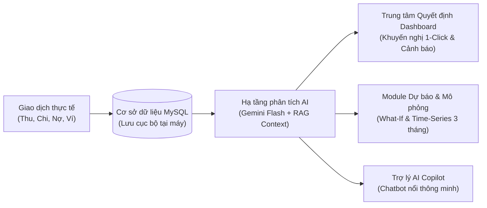

# TÀI LIỆU HƯỚNG DẪN SỬ DỤNG

## HỆ THỐNG HỖ TRỢ RA QUYẾT ĐỊNH TÀI CHÍNH CÁ NHÂN BẰNG AI (AI-FDSS)

---

> [!NOTE]
> **Thông tin đề tài & Kiến trúc hệ thống:**
>
> * **Tên hệ thống:** Personal Financial Decision Support System (AI-FDSS)
> * **Kiến trúc:** Ứng dụng Desktop Độc lập (Single-User Desktop Application)
> * **Nền tảng công nghệ:** Electron + React 19 + TypeScript + MySQL 8.0 + Google Gemini AI
> * **Triết lý thiết kế:** Bảo mật quyền riêng tư tối đa (Privacy-First), toàn bộ dữ liệu lưu trữ trực tiếp trên máy tính người dùng.

---

## MỤC LỤC

1. [Tổng quan &amp; Nguyên lý vận hành](#1-tổng-quan--nguyên-lý-vận-hành)
2. [Cấu trúc thành phần &amp; Tác dụng của từng Module](#2-cấu-trúc-thành-phần--tác-dụng-của-từng-module)
   - [Module 1: Quản lý Thu Chi &amp; Dòng tiền](#module-1-quản-lý-thu-chi--dòng-tiền-cá-nhân)
   - [Module 2: Quản lý Ngân sách &amp; Tiết kiệm](#module-2-quản-lý-ngân-sách--tiết-kiệm)
   - [Module 3: Quản lý Công nợ Cá nhân](#module-3-quản-lý-công-nợ-cá-nhân)
   - [Module 4: Báo cáo &amp; Phân tích Tài chính](#module-4-báo-cáo--phân-tích-tài-chính)
   - [Module 5: Hỗ trợ Ra Quyết định bằng AI (Trọng tâm)](#module-5-hỗ-trợ-ra-quyết-định-bằng-ai-trọng-tâm-đề-tài)
   - [Module 6: Cài đặt &amp; Tiện ích Hệ thống](#module-6-cài-đặt--tiện-ích-hệ-thống)
3. [Quy trình Hướng dẫn Sử dụng từng bước (Step-by-Step)](#3-quy-trình-hướng-dẫn-sử-dụng-từng-bước)
   - [Bước 1: Thiết lập Ví tiền ban đầu](#bước-1-thiết-lập-ví-tiền-ban-đầu)
   - [Bước 2: Ghi chép Giao dịch Thu - Chi hàng ngày](#bước-2-ghi-chép-giao-dịch-thu---chi-hàng-ngày)
   - [Bước 3: Thiết lập Ngân sách Chi tiêu](#bước-3-thiết-lập-ngân-sách-chi-tiêu)
   - [Bước 4: Sử dụng Trung tâm Quyết định AI trên Dashboard](#bước-4-sử-dụng-trung-tâm-quyết-định-ai-trên-dashboard)
   - [Bước 5: Thử nghiệm Kịch bản What-If trước khi Mua sắm lớn](#bước-5-thử-nghiệm-kịch-bản-what-if-trước-khi-mua-sắm-lớn)
   - [Bước 6: Trò chuyện và Hỏi đáp với Trợ lý AI Copilot](#bước-6-trò-chuyện-và-hỏi-đáp-với-trợ-lý-ai-copilot)
   - [Bước 7: Sao lưu &amp; Bảo vệ Dữ liệu Cục bộ](#bước-7-sao-lưu--bảo-vệ-dữ-liệu-cục-bộ)
4. [Các Lưu ý Quan trọng để Đạt Hiệu quả Cao nhất](#4-các-lưu-ý-quan-trọng-để-đạt-hiệu-quả-cao-nhất)

---

## 1. TỔNG QUAN & NGUYÊN LÝ VẬN HÀNH

Hệ thống **AI-FDSS** là phần mềm máy tính hỗ trợ người dùng theo dõi toàn diện dòng tiền cá nhân, đồng thời tích hợp **Trí tuệ nhân tạo (Generative AI & Phân tích Chuỗi thời gian Time-Series)** nhằm đóng vai trò như một **Cố vấn tài chính ảo cá nhân**:



### Nguyên lý cốt lõi:

1. **Dữ liệu thực tế là nền tảng (Ground Truth):** Mọi khuyến nghị của AI không dựa trên lý thuyết chung chung mà bám sát số dư ví, mức thu nhập, thói quen chi tiêu và áp lực nợ thực tế của bạn.
2. **Hỗ trợ quyết định, không ép buộc:** AI đưa ra các phương án hành động kèm theo lý do và mức độ tác động dự kiến; quyền chấp thuận áp dụng quyết định thuộc về người dùng (1-Click Apply).
3. **Mô hình Trừ điểm vi phạm (Penalty Model):** Điểm sức khỏe tài chính khởi đầu ở mức tối đa **100/100** *(Hoàn hảo - Sạch nợ)* và chỉ bị trừ điểm khi có dấu hiệu rủi ro (chi vượt thu, nợ quá hạn, vỡ ngân sách).

---

## 2. CẤU TRÚC THÀNH PHẦN & TÁC DỤNG CỦA TỪNG MODULE

Hệ thống được tổ chức thành 6 Module chức năng chặt chẽ theo biểu đồ phân rã chức năng nghiệp vụ (BFD):

### Module 1: Quản lý Thu Chi & Dòng tiền Cá nhân

| Thành phần                                    | Chức năng chi tiết                                                                                                             | Tác dụng đối với người dùng                                                                                                 |
| :---------------------------------------------- | :-------------------------------------------------------------------------------------------------------------------------------- | :---------------------------------------------------------------------------------------------------------------------------------- |
| **1.1 Quản lý Ví tiền & Tài khoản** | Khai báo, chỉnh sửa các nguồn tiền (Tiền mặt, Tài khoản Vietcombank, MB Bank, Ví MoMo, ZaloPay).                       | Giúp quản lý tập trung toàn bộ tài sản thanh khoản tại một nơi, biết chính xác tổng số tiền khả dụng đang có. |
| **1.2 Quản lý Danh mục Thu/Chi**       | Phân loại các khoản tiền theo nhóm (Ăn uống, Đi lại, Nhà cửa, Mua sắm, Lương, Thưởng...).                        | Tạo cấu trúc phân nhóm khoa học để bóc tách rõ tiền đi đâu về đâu, làm dữ liệu đầu vào cho AI rà soát.    |
| **1.3 Ghi chép Giao dịch**              | Ghi nhận chi tiết từng khoản thu nhập, khoản chi tiêu và chuyển khoản giữa các ví.                                   | Lưu trữ nhật ký biến động tài sản theo thời gian thực; tự động cộng/trừ số dư ví ngay khi lưu.                  |
| **1.4 Giao dịch Định kỳ Tự động**  | Lập lịch các khoản tiền cố định hàng tháng (Tiền thuê nhà, Tiền internet, Lương ngày 5, Tiết kiệm tự động). | Tự động hóa thanh toán định kỳ, loại bỏ rủi ro quên đóng phí hoặc quên hạch toán thu nhập đều đặn.          |

---

### Module 2: Quản lý Ngân sách & Tiết kiệm

| Thành phần                                            | Chức năng chi tiết                                                                                                           | Tác dụng đối với người dùng                                                                              |
| :------------------------------------------------------ | :------------------------------------------------------------------------------------------------------------------------------ | :--------------------------------------------------------------------------------------------------------------- |
| **2.1 Thiết lập Hạn mức Ngân sách**         | Khai báo trần chi tiêu tối đa trong tháng cho từng danh mục (VD: Ăn uống tối đa 4.000.000 đ/tháng).               | Thiết lập "kỷ luật chi tiêu", ngăn chặn thói quen vung tay quá trán từ đầu tháng.                  |
| **2.2 Giám sát Tỷ lệ Chi tiêu & Cảnh báo** | Đo lường tỷ lệ % chi tiêu thực tế so với hạn mức (màu xanh: an toàn; vàng: sắp chạm trần; đỏ: vượt trần). | Đưa ra cảnh báo kịp thời ngay trên Dashboard trước khi bạn chi tiêu vượt quá giới hạn cho phép. |
| **2.3 Mục tiêu Tiết kiệm Tích lũy**         | Tạo mục tiêu tài sản tương lai (Mua laptop, Quỹ du lịch, Quỹ khẩn cấp) kèm số tiền đích và hạn hoàn thành. | Theo dõi tiến độ tích lũy trực quan, tạo động lực tiết kiệm dài hạn có định hướng rõ ràng. |

---

### Module 3: Quản lý Công nợ Cá nhân

| Thành phần                                        | Chức năng chi tiết                                                                                                                     | Tác dụng đối với người dùng                                                                                          |
| :-------------------------------------------------- | :---------------------------------------------------------------------------------------------------------------------------------------- | :--------------------------------------------------------------------------------------------------------------------------- |
| **3.1 Sổ Theo dõi Công nợ**               | Quản lý 2 chiều: Nợ phải thu*(Cho người khác mượn)* và Nợ phải trả *(Vay nợ ngân hàng/bạn bè)*.                    | Tránh việc quên các khoản tiền đã cho mượn và kiểm soát chặt chẽ các nghĩa vụ nợ phải trả.              |
| **3.2 Ghi nhận Thanh toán Nợ từng đợt** | Cho phép trả góp / thu nợ nhiều lần, tự động cập nhật số dư còn lại và tự động cộng/trừ vào ví tiền tương ứng. | Quản lý minh bạch lịch sử trả nợ từng đợt, tránh nhầm lẫn giữa nợ gốc và các đợt hoàn tất thanh toán. |
| **3.3 Cảnh báo & Nhắc nợ Đến hạn**     | Đánh dấu các khoản nợ sắp đến ngày trả hoặc đã bị quá hạn thanh toán.                                                   | Giúp bảo vệ uy tín cá nhân, tránh bị phạt lãi suất quá hạn hoặc mất mối quan hệ vì quên trả nợ.         |

---

### Module 4: Báo cáo & Phân tích Tài chính

| Thành phần                                   | Chức năng chi tiết                                                                                                   | Tác dụng đối với người dùng                                                                                  |
| :--------------------------------------------- | :---------------------------------------------------------------------------------------------------------------------- | :------------------------------------------------------------------------------------------------------------------- |
| **4.1 Dashboard Tổng quan Tài chính** | Các thẻ chỉ số KPI tổng số dư, thu nhập tháng, chi tiêu tháng, dòng tiền ròng, công nợ và tiết kiệm. | Nắm bắt toàn bộ sức khỏe dòng tiền cá nhân trong vòng**3 giây** ngay khi mở ứng dụng.           |
| **4.2 Biểu đồ Cơ cấu & Xu hướng** | Biểu đồ cột Thu - Chi 12 tháng và biểu đồ tròn phân bổ chi tiêu theo danh mục.                            | Trực quan hóa hành vi tài chính: nhận diện ngay danh mục nào đang "ngốn" nhiều tiền nhất trong tháng. |
| **4.3 Xuất Báo cáo Dữ liệu Ngoài** | Hỗ trợ xuất toàn bộ lịch sử thu/chi/nợ ra file bảng tính CSV.                                                 | Tiện lợi cho việc lưu trữ dự phòng ngoài máy, in ấn báo cáo hoặc kiểm toán chi tiêu cá nhân.       |

---

### Module 5: Hỗ trợ Ra Quyết định bằng AI (Trọng tâm đề tài)

Module 5 là trái tim công nghệ của đề tài, được chia thành 3 phân hệ trực quan:

```
[Module 5: AI-Powered Decision Support]
  │
  ├── 1. TẠI DASHBOARD (Trung tâm Chỉ huy):
  │     ├── 5.1 Đánh giá Sức khỏe Tài chính (Thang 100 điểm, cơ chế trừ điểm vi phạm)
  │     ├── 5.2 Quét & Cảnh báo Chi tiêu Bất thường (Anomaly Detection)
  │     └── 5.5 Khuyến nghị Quyết định Hành động 1-Click (Actionable Recommendations)
  │
  ├── 2. TẠI MODULE RIÊNG "DỰ BÁO & MÔ PHỎNG":
  │     ├── 5.3 Dự báo Dòng tiền 3 Tháng Tới (Time-Series Forecasting)
  │     └── 5.4 Mô phỏng Kịch bản Giả định What-If (Mua xe, trả góp, giảm thu nhập)
  │
  └── 3. TOÀN ỨNG DỤNG:
        └── 5.6 Trợ lý Cố vấn AI Copilot (Chatbot nổi truy vấn số liệu thực tế qua RAG)
```

| Thành phần                                      | Chức năng chi tiết                                                                                                                                                                     | Tác dụng đối với người dùng                                                                                                                                              |
| :------------------------------------------------ | :---------------------------------------------------------------------------------------------------------------------------------------------------------------------------------------- | :------------------------------------------------------------------------------------------------------------------------------------------------------------------------------- |
| **5.1 Đánh giá Sức khỏe Tài chính**  | Đánh giá tổng hợp điểm số từ 0 - 100 điểm dựa trên Quỹ khẩn cấp, Dòng tiền thặng dư và Tỷ lệ nợ.                                                                  | Đo lường mức độ an toàn tài chính. Khởi đầu chuẩn 100/100, chỉ giảm điểm khi phát sinh vi phạm.                                                               |
| **5.2 Quét Chi tiêu Bất thường**       | Tự động so sánh từng khoản chi với mức chi tiêu trung bình quá khứ của danh mục đó để phát hiện đột biến.                                                          | Ngăn chặn việc rò rỉ ngân sách, phát hiện ngay các khoản chi tiêu bất hợp lý hoặc bị tính trùng.                                                              |
| **5.3 Dự báo Dòng tiền Tương lai**    | Dự báo số dư ví, doanh thu dự tính và chi phí dự tính trong 3 tháng tới kèm kịch bản thận trọng & tích cực.                                                           | Giúp người dùng nhìn thấy trước tương lai tài chính, chuẩn bị tiền cho các kỳ đóng học phí, tết, sự kiện lớn.                                           |
| **5.4 Mô phỏng Kịch bản What-If**       | Người dùng nhập thử món đồ muốn mua sắm lớn (xe máy, điện thoại, laptop...) kèm khoản trả trước và trả góp. AI phân tích và kết luận có nên mua hay không. | Tránh rơi vào bẫy nợ nần và khủng hoảng thanh khoản; biết chính xác mua món đồ này thì số dư các tháng tới ra sao.                                        |
| **5.5 Khuyến nghị Quyết định 1-Click** | Đưa ra các giải pháp hành động cụ thể (VD: "Cắt giảm 15% ăn vặt để đạt mục tiêu tiết kiệm") kèm nút**"Áp dụng quyết định"**.                           | Biến lời khuyên AI thành hành động thực tế chỉ bằng 1 cú nhấp chuột mà không cần tự điều chỉnh thủ công.                                                  |
| **5.6 Trợ lý AI Copilot (Chatbot nổi)**  | Khung chat thông minh thường trực ở góc màn hình. Sử dụng công nghệ RAG nạp số liệu ví và thu chi thực tế để đối thoại.                                           | Đóng vai trò chuyên gia tài chính giải đáp mọi băn khoăn:*"Tháng này tôi còn bao nhiêu tiền tiêu?", "Tôi có nên đổi điện thoại bây giờ không?"*. |

---

### Module 6: Cài đặt & Tiện ích Hệ thống

| Thành phần                                           | Chức năng chi tiết                                                                                                        | Tác dụng đối với người dùng                                                                                                      |
| :----------------------------------------------------- | :--------------------------------------------------------------------------------------------------------------------------- | :--------------------------------------------------------------------------------------------------------------------------------------- |
| **6.1 Tùy chọn Mô hình AI theo Mục đích** | Bộ chọn mô hình Google Gemini (Gemini 3 Flash Preview, Gemini 3.8 Flash, 3.5 Flash...). Tự động ẩn API key an toàn. | Người dùng dễ dàng chuyển đổi linh hoạt mô hình AI theo nhu cầu: Tốc độ cao, Lập luận chuyên sâu, hoặc Đa tác vụ. |
| **6.2 Sao lưu & Phục hồi Dữ liệu**          | Xuất toàn bộ dữ liệu MySQL ra file dự phòng`.sql` và cho phép khôi phục nguyên trạng bất cứ lúc nào.      | Đảm bảo an toàn dữ liệu tuyệt đối trước các sự cố hỏng hóc hệ điều hành hoặc khi chuyển máy tính.                |
| **6.3 Kiểm tra Kết nối Database Cục bộ**    | Công cụ ping và kiểm tra tình trạng cổng kết nối MySQL 3306 cục bộ.                                               | Giúp người dùng tự chuẩn đoán và phát hiện lỗi kết nối cơ sở dữ liệu nếu dịch vụ MySQL bị tắt.                    |

---

## 3. QUY TRÌNH HƯỚNG DẪN SỬ DỤNG TỪNG BƯỚC

### Bước 1: Thiết lập Ví tiền ban đầu

Khi bắt đầu sử dụng, bạn cần khai báo số tiền hiện có của mình:

1. Nhấp vào mục **Cài đặt & Dữ liệu** hoặc biểu tượng ví tiền.
2. Thêm hoặc cập nhật số dư cho các ví mặc định:
   * **Tiền mặt:** Số tiền thực tế đang có trong ví vật lý.
   * **Tài khoản Ngân hàng (Vietcombank...):** Số dư trên ứng dụng ngân hàng.
   * **Ví điện tử (MoMo...):** Số dư trên ví MoMo.
3. Nhấn **Lưu thay đổi**. Ngay lập tức, thẻ **TỔNG SỐ DƯ** trên Dashboard sẽ cập nhật số tiền hiện có của bạn.

---

### Bước 2: Ghi chép Giao dịch Thu - Chi hàng ngày

1. Ở bất kỳ màn hình nào, nhấp vào nút **`+ Thêm giao dịch`** (màu xanh) ở góc trên thanh Topbar.
2. Chọn loại giao dịch:
   * **Chi tiêu:** Mua sắm, ăn uống, đi lại, hóa đơn...
   * **Thu nhập:** Lương, tiền thưởng, tiền làm thêm...
   * **Chuyển tiền:** Chuyển tiền từ Tài khoản ngân hàng sang Ví MoMo hoặc rút tiền mặt.
3. Điền các trường: *Số tiền*, *Danh mục*, *Ví thanh toán*, *Ngày giao dịch* và *Ghi chú*.
4. Nhấn **Xác nhận lưu**: Số dư ví tương ứng sẽ được tự động cập nhật ngay lập tức.

---

### Bước 3: Thiết lập Ngân sách Chi tiêu

1. Điều hướng đến menu **TÀI CHÍNH $\rightarrow$ Ngân sách**.
2. Nhấn nút **`+ Thêm ngân sách`**.
3. Đặt tên (VD: *Ngân sách Ăn uống Tháng này*).
4. Nhập hạn mức tối đa (VD: *4.000.000 đ*).
5. Tích chọn danh mục áp dụng: *Ăn uống, Cà phê*.
6. Nhấn **Lưu**. Khi bạn chi tiêu cho nhóm này, thanh tiến độ sẽ tăng dần và cảnh báo sẽ xuất hiện trên Dashboard nếu chạm ngưỡng 80% hoặc vượt trần 100%.

---

### Bước 4: Sử dụng Trung tâm Quyết định AI trên Dashboard

Tại màn hình chính **Dashboard**, khối **"Khuyến nghị & Quyết định Tài chính từ AI"** hoạt động tự động:

1. **Kiểm tra Điểm sức khỏe:** Nhìn vào huy hiệu điểm (VD: `100/100`). Nếu muốn chấm lại điểm dựa trên thu chi gần nhất, nhấn **"Đo lại điểm"**.
2. **Quét Chi tiêu Bất thường:** Nhấn nút **"Quét chi tiêu lạ"**. Nếu có giao dịch tăng đột biến 2-3 lần so với thói quen cũ, thẻ cảnh báo màu hồng sẽ xuất hiện nêu rõ nguyên nhân và cách xử lý.
3. **Thực hiện Khuyến nghị 1-Click:**
   * Đọc gợi ý từ AI (VD: *"Tạo ngân sách mua sắm để bảo vệ dòng tiền"*).
   * Nếu đồng ý: Nhấn **"Áp dụng quyết định"** $\rightarrow$ Hệ thống tự động tạo ngân sách hoặc cấu hình kế hoạch cho bạn mà không cần nhập lại.
   * Nếu không cần thiết: Nhấn **"Bỏ qua"**.
   * Nhấn **"Phân tích lại với AI"** bất cứ lúc nào để làm mới các gợi ý.

---

### Bước 5: Thử nghiệm Kịch bản What-If trước khi Mua sắm lớn

Khi bạn có ý định mua một món đồ đắt tiền (Laptop 25 triệu, Xe máy trả góp 35 triệu...):

1. Điều hướng đến menu **PHÂN TÍCH & DỰ BÁO $\rightarrow$ Dự báo & Mô phỏng**.
2. Cuộn xuống phần **Công cụ Mô phỏng Kịch bản Giả định (What-If Analysis)**.
3. Điền thông số dự tính:
   * **Tên kịch bản:** Mua xe tay ga trả góp
   * **Giá trị món đồ:** 35.000.000 đ
   * **Số tiền trả trước:** 10.000.000 đ
   * **Trả góp mỗi tháng:** 2.500.000 đ
   * **Thời hạn:** 12 tháng
4. Nhấn nút **"Chạy Mô phỏng & Đánh giá Rủi ro"**.
5. AI sẽ lấy số dư ví hiện tại và dòng tiền thặng dư hàng tháng của bạn để phân tích:
   * *Nếu dòng tiền an toàn:* AI thông báo bạn đủ năng lực tài chính và khuyến nghị thời điểm mua tối ưu.
   * *Nếu rủi ro cao:* AI cảnh báo nguy cơ cạn kiệt quỹ dự phòng và gợi ý bạn nên tích lũy thêm bao nhiêu tháng nữa trước khi mua.

---

### Bước 6: Trò chuyện và Hỏi đáp với Trợ lý AI Copilot

1. Nhấp vào nút tròn nổi **`✨ Hỏi Trợ lý AI`** ở góc dưới bên phải màn hình.
2. Cửa sổ Chatbot mở ra với trạng thái kết nối trực tiếp cơ sở dữ liệu (`Đang hoạt động - RAG Finance`).
3. Bạn có thể bấm các câu hỏi nhanh:
   * *"Tháng này tôi còn bao nhiêu tiền tiêu?"*
   * *"Đánh giá cơ cấu chi tiêu của tôi"*
   * *"Cho tôi 1 lời khuyên tiết kiệm"*
4. Hoặc tự gõ bất kỳ câu hỏi tài chính nào của bạn bằng tiếng Việt tự nhiên (VD: *"Tháng này tôi có khoản nợ nào sắp đến hạn không?", "Tiền cà phê tháng này chiếm bao nhiêu phần trăm?"*).
5. Trợ lý AI sẽ đọc dữ liệu trong database và trả lời cụ thể, chính xác đến từng con số cho bạn.

---

### Bước 7: Sao lưu & Bảo vệ Dữ liệu Cục bộ

Để bảo vệ an toàn cho toàn bộ dữ liệu tài chính của bạn:

1. Vào menu **HỆ THỐNG $\rightarrow$ Cài đặt & Sao lưu**.
2. Tại mục **Hệ thống & Cơ sở dữ liệu**:
   * Nhấn **"Kiểm tra kết nối"** để chắc chắn database MySQL đang hoạt động tốt.
   * Nhấn **"Sao lưu ngay"** để tạo bản sao lưu dữ liệu toàn bộ hệ thống về máy tính cá nhân.
   * Nhấn **"Xuất CSV"** để xuất lịch sử giao dịch ra file Excel dự phòng.

---

## 4. CÁC LƯU Ý QUAN TRỌNG ĐỂ ĐẠT HIỆU QUẢ CAO NHẤT

> [!TIP]
> **Thói quen ghi chép:** Hãy ghi chép các khoản chi tiêu ngay khi phát sinh (trong ngày) để số liệu trên Dashboard và các phân tích của AI luôn phản ánh đúng thực tế nhất.

> [!IMPORTANT]
> **Tùy chọn Mô hình AI trong Cài đặt:**
>
> * Nếu bạn muốn tốc độ phản hồi nhanh nhất và thao tác mượt mà: Chọn **Gemini 3 Flash Preview (Khuyên dùng)**.
> * Nếu bạn muốn chạy phân tích chuyên sâu về lập luận tài chính: Chọn **Gemini 3.5 Flash** hoặc **Gemini 3.8 Flash**.
> * Nhớ nhấn **"Lưu thay đổi"** khi chọn mô hình mới để hệ thống kích hoạt.

> [!CAUTION]
> **Bảo mật file `.env`:** Khóa Google Gemini API Key và mật khẩu cơ sở dữ liệu MySQL được lưu trữ an toàn trong file `.env` cục bộ trên máy tính của bạn. Không chia sẻ file `.env` cho người khác để đảm bảo an toàn thông tin cá nhân.
