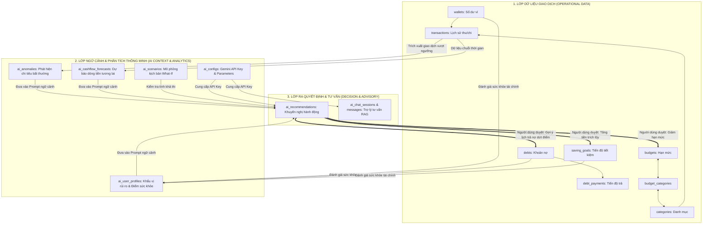

# TÀI LIỆU THIẾT KẾ HỆ THỐNG & SƠ ĐỒ KIẾN TRÚC (BFD & ERD)
## Đề tài: Hệ thống hỗ trợ ra quyết định tài chính cá nhân bằng AI (AI-FDSS)

---

## MỤC LỤC
1. [Sơ đồ Phân rã Chức năng (BFD - Business Function Diagram)](#1-sơ-đồ-phân-rã-chức-năng-bfd)
2. [Sơ đồ Quan hệ Thực thể Vật lý (Physical ERD - 17 Bảng)](#2-sơ-đồ-quan-hệ-thực-thể-vật-lý-physical-erd)
3. [Sơ đồ Quan hệ Logic & Luồng Ra quyết định (Logical ERD & Decision Loop)](#3-sơ-đồ-quan-hệ-logic--luồng-ra-quyết-định)
4. [Từ điển Dữ liệu & Giải trình Thiết kế Liên kết](#4-từ-điển-dữ-liệu--giải-trình-thiết-kế-liên-kết)
5. [Hướng dẫn Báo cáo & Trả lời Hội đồng Phản biện](#5-hướng-dẫn-báo-cáo--trả-lời-hội-đồng-phản-biện)

---

## 1. Sơ đồ Phân rã Chức năng (BFD)

Sơ đồ BFD phân cấp toàn bộ chức năng của hệ thống từ mức tổng quát (Mức 0) đến các phân hệ nghiệp vụ (Mức 1) và chức năng chi tiết (Mức 2).

```mermaid
graph TD
    ROOT["0.0 HỆ THỐNG HỖ TRỢ RA QUYẾT ĐỊNH<br>TÀI CHÍNH CÁ NHÂN BẰNG AI (AI-FDSS)"]

    %% MỨC 1
    F1["1.0 Quản lý Thu Chi<br>& Dòng tiền"]
    F2["2.0 Quản lý Ngân sách<br>& Tiết kiệm"]
    F3["3.0 Quản lý Công nợ<br>& Thanh toán"]
    F4["4.0 Báo cáo Thống kê<br>& Trực quan hóa"]
    F5["5.0 Hỗ trợ Ra quyết định<br>bằng AI (Trọng tâm)"]
    F6["6.0 Quản trị &<br>Cấu hình Hệ thống"]

    ROOT --> F1
    ROOT --> F2
    ROOT --> F3
    ROOT --> F4
    ROOT --> F5
    ROOT --> F6

    %% MỨC 2 - F1
    F1 --> F11["1.1 Quản lý Ví & Tài khoản"]
    F1 --> F12["1.2 Quản lý Danh mục Thu/Chi"]
    F1 --> F13["1.3 Ghi nhận Giao dịch (Thu/Chi/Chuyển ví)"]
    F1 --> F14["1.4 Cấu hình Giao dịch Định kỳ tự động"]

    %% MỨC 2 - F2
    F2 --> F21["2.1 Lập Ngân sách theo Kỳ & Danh mục"]
    F2 --> F22["2.2 Theo dõi Tỷ lệ sử dụng Ngân sách"]
    F2 --> F23["2.3 Thiết lập & Theo dõi Mục tiêu Tiết kiệm"]

    %% MỨC 2 - F3
    F3 --> F31["3.1 Quản lý Khoản Phải thu / Phải trả"]
    F3 --> F32["3.2 Ghi nhận Thanh toán từng đợt"]
    F3 --> F33["3.3 Theo dõi & Cảnh báo Nợ quá hạn"]

    %% MỨC 2 - F4
    F4 --> F41["4.1 Dashboard Tổng quan Số dư & Dòng tiền"]
    F4 --> F42["4.2 Biểu đồ Cơ cấu Chi tiêu theo Danh mục"]
    F4 --> F43["4.3 Xuất Báo cáo CSV / Excel"]

    %% MỨC 2 - F5 (CỐT LÕI AI DSS)
    F5 --> F51["5.1 Đánh giá Sức khỏe Tài chính & Khẩu vị Rủi ro"]
    F5 --> F52["5.2 Phát hiện Chi tiêu Bất thường (Anomaly Detection)"]
    F5 --> F53["5.3 Dự báo Dòng tiền & Số dư Tương lai (Forecasting)"]
    F5 --> F54["5.4 Mô phỏng Kịch bản Giả định (What-If Scenarios)"]
    F5 --> F55["5.5 Sinh Khuyến nghị Quyết định & Tự động Thực thi"]
    F5 --> F56["5.6 Trợ lý Tư vấn Tài chính Ngôn ngữ Tự nhiên (Chatbot)"]

    %% MỨC 2 - F6
    F6 --> F61["6.1 Cấu hình AI Provider & API Key"]
    F6 --> F62["6.2 Sao lưu (Backup) & Phục hồi (Restore) Database"]
    F6 --> F63["6.3 Kiểm tra Kết nối Cơ sở Dữ liệu"]
```

---

## 2. Sơ đồ Quan hệ Thực thể Vật lý (Physical ERD)

Sơ đồ chi tiết 17 bảng trong cơ sở dữ liệu MySQL `personal_finance`, thể hiện khóa chính (PK), khóa ngoại (FK) và kiểu dữ liệu chuẩn:

```mermaid
erDiagram
    %% QUAN HỆ CỐT LÕI
    WALLETS ||--o{ TRANSACTIONS : "thực hiện (1-N)"
    CATEGORIES ||--o{ TRANSACTIONS : "phân loại (1-N)"
    WALLETS ||--o{ RECURRING_TRANSACTIONS : "nguồn tiền (1-N)"
    CATEGORIES ||--o{ RECURRING_TRANSACTIONS : "phân loại (1-N)"
    BUDGETS ||--|{ BUDGET_CATEGORIES : "gồm các mục (1-N)"
    CATEGORIES ||--|{ BUDGET_CATEGORIES : "áp dụng cho (1-N)"
    DEBTS ||--o{ DEBT_PAYMENTS : "được trả bởi (1-N)"
    WALLETS ||--o{ DEBT_PAYMENTS : "chi/nhận tiền (1-N)"

    %% QUAN HỆ VỚI PHÂN HỆ AI
    TRANSACTIONS ||--o{ AI_ANOMALIES : "bị cảnh báo (1-N)"
    CATEGORIES ||--o{ AI_ANOMALIES : "danh mục bất thường (1-N)"
    AI_CHAT_SESSIONS ||--|{ AI_CHAT_MESSAGES : "chứa tin nhắn (1-N)"

    WALLETS {
        int id PK
        varchar name
        decimal initial_balance
        decimal current_balance
        tinyint is_active
        timestamp created_at
        timestamp updated_at
    }

    CATEGORIES {
        int id PK
        varchar name
        enum type "income | expense"
        varchar description
        tinyint is_active
        timestamp created_at
        timestamp updated_at
    }

    TRANSACTIONS {
        bigint id PK
        int wallet_id FK
        int category_id FK
        enum type "income | expense | transfer | adjustment"
        decimal amount
        datetime transaction_date
        varchar note
        bigint transfer_id
        timestamp created_at
    }

    BUDGETS {
        int id PK
        varchar name
        decimal amount
        date start_date
        date end_date
        varchar description
        timestamp created_at
    }

    BUDGET_CATEGORIES {
        int budget_id PK,FK
        int category_id PK,FK
    }

    DEBTS {
        bigint id PK
        enum type "receivable | payable"
        varchar person_name
        decimal original_amount
        decimal remaining_amount
        date created_date
        date due_date
        enum status "unpaid | partial | paid | overdue"
        timestamp created_at
    }

    DEBT_PAYMENTS {
        bigint id PK
        bigint debt_id FK
        int wallet_id FK
        decimal amount
        datetime payment_date
        varchar note
        timestamp created_at
    }

    SAVING_GOALS {
        int id PK
        varchar name
        decimal target_amount
        decimal current_amount
        date target_date
        varchar description
        enum status "active | completed | cancelled"
        timestamp created_at
    }

    RECURRING_TRANSACTIONS {
        int id PK
        int wallet_id FK
        int category_id FK
        enum type "income | expense"
        decimal amount
        varchar description
        enum frequency "daily | weekly | monthly | yearly"
        date next_date
        tinyint is_active
    }

    AI_USER_PROFILES {
        int id PK
        enum risk_tolerance "conservative | moderate | aggressive"
        decimal monthly_baseline_income
        int emergency_fund_target_months
        decimal financial_health_score
        json financial_priorities
        datetime last_analyzed_at
        timestamp updated_at
    }

    AI_RECOMMENDATIONS {
        bigint id PK
        enum type "budget_adjustment | debt_strategy | spending_cut | saving_boost | emergency_fund_alert | cashflow_warning"
        varchar title
        text summary
        text detailed_reasoning
        decimal potential_savings
        json action_payload
        enum status "pending | accepted | rejected | dismissed"
        decimal confidence_score
        timestamp created_at
        datetime applied_at
    }

    AI_CASHFLOW_FORECASTS {
        bigint id PK
        varchar forecast_period
        decimal predicted_income
        decimal predicted_expense
        decimal predicted_ending_balance
        decimal lower_bound_balance
        decimal upper_bound_balance
        varchar model_name
        timestamp created_at
    }

    AI_SCENARIOS {
        int id PK
        varchar name
        enum scenario_type "income_loss | large_expense | inflation | career_change | custom"
        json parameters
        json simulation_result
        text ai_evaluation
        timestamp created_at
    }

    AI_ANOMALIES {
        bigint id PK
        bigint transaction_id FK
        int category_id FK
        enum severity "low | medium | high | critical"
        varchar anomaly_type
        varchar description
        varchar suggested_action
        tinyint is_resolved
        timestamp created_at
    }

    AI_CHAT_SESSIONS {
        bigint id PK
        varchar title
        text context_summary
        timestamp created_at
        timestamp updated_at
    }

    AI_CHAT_MESSAGES {
        bigint id PK
        bigint session_id FK
        enum role "user | assistant | system"
        mediumtext content
        json referenced_data
        int tokens_used
        timestamp created_at
    }

    AI_CONFIGS {
        int id PK
        varchar provider "gemini | openai | deepseek"
        varchar api_key
        varchar model_name
        decimal temperature
        int max_tokens
        tinyint is_active
        timestamp updated_at
    }
```

---

## 3. Sơ đồ Quan hệ Logic & Luồng Ra quyết định

Biểu diễn cách hệ thống thu thập dữ liệu giao dịch, đưa qua bộ suy diễn AI và tạo thành **Vòng lặp Ra quyết định khép kín (Closed Decision Loop)**:

---

## 4. Từ điển Dữ liệu & Giải trình Thiết kế Liên kết

> [!NOTE]
> **Giải thích câu hỏi kinh điển của Hội đồng phản biện:** *"Tại sao các bảng `ai_recommendations`, `saving_goals`, `ai_scenarios` không có khóa ngoại (Foreign Key) nối trực tiếp?"*

### 4.1. Bảng `ai_recommendations` (Khuyến nghị hành động)
* **Bản chất thiết kế:** **Đa hình (Polymorphic Reference)**.
* **Lý do không dùng Foreign Key cứng:**
  Một khuyến nghị từ AI có thể nhắm tới nhiều thực thể khác nhau:
  - Khuyến nghị giảm chi tiêu $\rightarrow$ Trỏ tới `categories`
  - Khuyến nghị trả nợ Snowball/Avalanche $\rightarrow$ Trỏ tới `debts`
  - Khuyến nghị cân chỉnh hạn mức $\rightarrow$ Trỏ tới `budgets`
  - Nếu tạo 3 cột FK thì 2 cột sẽ luôn bị `NULL`. Nguy hiểm hơn, nếu người dùng xóa một khoản nợ cũ thì lịch sử khuyến nghị của AI trong quá khứ sẽ bị xóa theo (lỗi vi phạm toàn vẹn lịch sử).
* **Giải pháp chuẩn:** Lưu tham chiếu mục tiêu vào cột **`action_payload` (JSON)**. Khi người dùng bấm *"Chấp nhận"*, Backend giải mã JSON này để cập nhật đúng bảng mục tiêu.

### 4.2. Bảng `saving_goals` (Mục tiêu tiết kiệm)
* **Bản chất thiết kế:** **Chỉ tiêu tích lũy ảo (Virtual Metric)**.
* **Lý do không nối cứng vào `wallets`:**
  Tiền tiết kiệm có thể phân bổ linh hoạt ở nhiều nơi (một phần tiền mặt, một phần gửi ngân hàng, một phần ví điện tử). Mục tiêu tiết kiệm là thước đo tiến độ của người dùng, không được khóa cứng vào một ví cố định nào nhằm đảm bảo tính linh động của dòng tiền thực tế.

### 4.3. Bảng `ai_cashflow_forecasts` & `ai_scenarios`
* **Bản chất thiết kế:** **Dữ liệu phân tích vĩ mô (Analytical Aggregate Data)**.
* `ai_cashflow_forecasts` lưu trữ dự báo số dư toàn hệ thống theo chuỗi thời gian (tháng/quý), được tính toán tổng hợp từ toàn bộ dữ liệu lịch sử chứ không phụ thuộc vào một giao dịch cá biệt.
* `ai_scenarios` lưu trữ các kịch bản giả định What-If (chưa xảy ra trong thực tế), hoàn toàn mang tính độc lập thử nghiệm.

### 4.4. Bảng `ai_user_profiles` & `ai_configs`
* **Bản chất thiết kế:** **Bảng cấu hình cấp hệ thống (Singleton Tables)**.
* Trong ứng dụng desktop cá nhân (Single-user), đây là 2 bảng định nghĩa hồ sơ của chính người dùng và cấu hình API Key dịch vụ AI. Khi mở rộng sang hệ thống đa người dùng (Multi-tenant), hai bảng này sẽ liên kết 1-1 với bảng `users`.

---

## 5. Hướng dẫn Báo cáo & Trả lời Hội đồng Phản biện

Khi bảo vệ đề tài, sinh viên cần nhấn mạnh **3 luận điểm cốt lõi** sau để làm nổi bật tính mới và hàm lượng công nghệ:

1. **Khác biệt giữa App Quản lý Chi tiêu và Hệ Hỗ trợ Ra Quyết định (DSS):**
   * *App thông thường:* Chỉ làm nhiệm vụ CRUD (Thêm, Sửa, Xóa) và vẽ lại các biểu đồ quá khứ.
   * *Hệ thống AI-FDSS này:* Tự động phân tích lịch sử $\rightarrow$ Đánh giá rủi ro (`ai_user_profiles`) $\rightarrow$ Phát hiện bất thường (`ai_anomalies`) $\rightarrow$ Dự báo tương lai (`ai_cashflow_forecasts`) $\rightarrow$ Đưa ra đề xuất hành động cụ thể (`ai_recommendations`).

2. **Tính khép kín của quyết định (Actionable Loop):**
   * Lời khuyên của AI không phải là đoạn văn bản suông để đọc giải trí, mà đi kèm `action_payload` JSON. Người dùng chỉ cần bấm **"Chấp nhận"** là hệ thống tự động cập nhật lại hạn mức ngân sách hoặc lịch trả nợ.

3. **Kiến trúc dữ liệu hiện đại:**
   * Kết hợp hài hòa giữa **RDBMS truyền thống** (đảm bảo tính toàn vẹn ACID của tiền tệ qua các khóa ngoại) và **Semi-structured Data (JSON)** cho các phân hệ AI (đảm bảo tính linh hoạt, mở rộng mô hình không cần sửa đổi schema).
